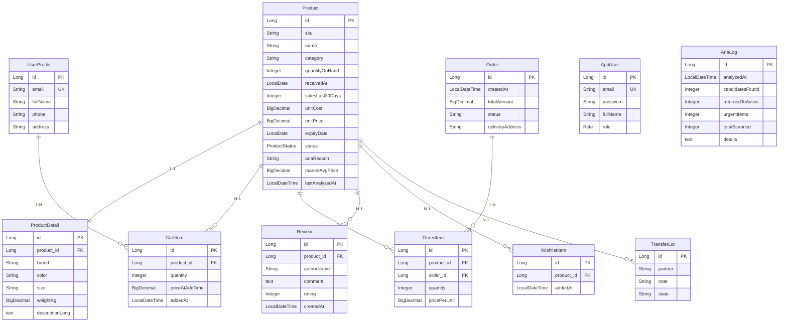

# ARIA Shop — магазин с модулем ARIA

## 1. Название и суть

ARIA Shop — это интернет-магазин с интеллектуальным модулем ARIA (Automatic Retail Inventory Analysis). Модуль анализирует инвентарь и выявляет проблемные товары:

- **Мёртвый сток** — товары, которые не продаются более 180 дней
- **Скоропортящиеся товары** — товары со сроком годности менее 30 дней
- **Отрицательная маржа** — товары, продающиеся ниже себестоимости
- **Завышенная цена** — товары с ценой выше рыночной на 20%+

Проблемные товары маркируются как кандидаты для передачи в благотворительные фонды. Система генерирует акты приёма-передачи для юридического оформления.

## 2. Стек

- **Java 21+**
- **Spring Boot 4.1.1**
- **Spring Data JPA + Hibernate** — ORM и работа с БД
- **Spring Security + JWT** — stateless аутентификация с ролями USER/ADMIN
- **H2** — in-memory БД для демо
- **PostgreSQL** — профиль для продакшена
- **JUnit 5 + Mockito + AssertJ** — unit-тесты без Spring context
- **Vanilla JS** — фронтенд без фреймворков

## 3. Запуск

### Сборка и запуск

```bash
mvnw clean package -DskipTests
java -jar target/*.jar
```

Приложение запускается на `http://localhost:8080`

### Демо-пользователи

Создаются автоматически через `DataSeeder` при старте:

- **Администратор**: `admin@aria.shop` / `admin123` (роль ADMIN)
- **Пользователь**: `user@aria.shop` / `user123` (роль USER)

### Переключение на PostgreSQL

```bash
java -jar target/*.jar --spring.profiles.active=postgres
```

Переменные окружения для PostgreSQL (опциональны, есть дефолты):

- `SPRING_DATASOURCE_URL` — дефолт: `jdbc:postgresql://localhost:5432/aria`
- `SPRING_DATASOURCE_USERNAME` — дефолт: `postgres`
- `SPRING_DATASOURCE_PASSWORD` — дефолт: `postgres`

## 4. Слои архитектуры

```
Controller → Service → Repository → Entity
```

- **Controller** — обработка HTTP-запросов, валидация, формирование JSON-ответов
- **Service** — бизнес-логика, транзакции, оркестрация репозиториев
- **Repository** — доступ к данным через Spring Data JPA
- **Entity** — JPA-сущности, маппинг на таблицы БД

## 5. ER-диаграмма



## 6. Паттерны проектирования

### Repository Pattern
**Где**: Все интерфейсы `*Repository` (`ProductRepository`, `OrderRepository`, и т.д.)

**Суть**: Абстракция доступа к данным. Spring Data JPA предоставляет готовую реализацию, мы только объявляем интерфейс с методами-запросами.

### Service Layer / Facade Pattern
**Где**: `AriaService`, `OrderService`, `CartService`, `FavoriteService`

**Суть**: Сервисный слой инкапсулирует бизнес-логику и управляет транзакциями. Контроллеры не знают о репозиториях — они общаются только через сервисы. `AriaService` — фасад для всей логики анализа инвентаря.

### DTO/Mapper Pattern
**Где**: Контроллеры возвращают `Map<String, Object>` вместо сериализации сущностей напрямую

**Суть**: Защита от LazyInitializationException и контроль над JSON-представлением. Прокси Hibernate не попадают в ответ, только скалярные поля.

### Strategy Pattern
**Где**: `CompetitorAnalyzerService` как стратегия расчёта рыночных цен

**Суть**: В демо-режиме сервис заглушён (mock) и возвращает фиксированные значения. В продакшене можно заменить реализацию на реальный API-агрегатор (например, Wildberries, Ozon, Яндекс Маркет) без изменения остального кода.

## 7. Безопасность

- **JWT stateless** — токен передаётся в заголовке `Authorization: Bearer <token>`, сессии на сервере не хранятся
- **Роли USER/ADMIN** — два уровня доступа: обычный пользователь и администратор
- **BCrypt** — пароли хранятся в БД только в виде bcrypt-хэша; даже при утечке БД пароли не восстанавливаются
- **Почему хэшируем** — пароль — секрет пользователя, который нельзя хранить в открытом виде. BCrypt добавляет соль и использует медленный хэш для защиты от брутфорса

## 8. Ограничения демо

- **Моковые рыночные цены** — `CompetitorAnalyzerService` возвращает фиксированные значения вместо реального парсинга
- **Один глобальный пользователь** — корзина и избранное не привязаны к конкретному пользователю (нет JWT-контекста в этих эндпоинтах)
- **Имитация доставки** — статус заказа сразу становится `SHIPPED`, реальная логística не реализована
- **H2 in-memory** — данные теряются при перезапуске (для продакшена использовать PostgreSQL)
