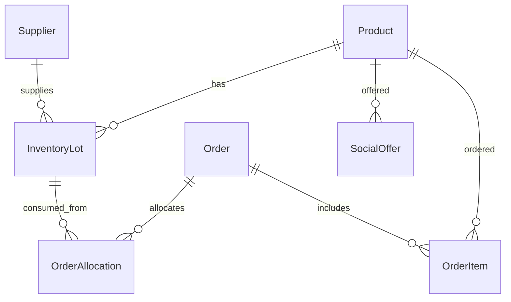

# Архитектура ARIA

Один Java 21 / Spring Boot backend обслуживает магазин, ARIA Control и организации. Данные хранятся в общей базе. Рабочее развёртывание использует PostgreSQL и Flyway; быстрый локальный запуск — файловую H2.

## Слои

Controllers принимают валидируемые DTO и передают действия сервисам. InventoryService управляет партиями и остатками. PricingService рассчитывает цену и ограничения. ControlService отвечает за справочники и скидки. OrderService оформляет заказ и хранит распределение по партиям. SocialService разделяет публикацию, резерв и подтверждённую передачу. AuditService пишет журнал в той же транзакции. Репозитории изолируют доступ к БД.

## Основные связи

## Два паттерна

Strategy: DiscountRule имеет независимые реализации ExpiryDiscountRule и SlowStockDiscountRule. PricingService собирает предложения правил и централизованно ограничивает их себестоимостью. Новое правило добавляется без изменения контроллеров.

Repository: ProductRepository, InventoryLotRepository и остальные интерфейсы Spring Data скрывают запросы и способы хранения от бизнес-логики. Транзакции задаются на сервисах, а не на фронтенде.

## Согласованность

Строка товара блокируется pessimistic write, затем обновляется из базы перед операцией. При работе с несколькими товарами оформитель берёт их в стабильном порядке. Корзина блокируется при checkout. Product дополнительно имеет optimistic version. Партии расходуются FEFO: срок, дата приёмки, ID. Allocation сохраняет точное распределение для отмены. Закрытые/просроченные партии не возвращаются в продажу только из-за отмены заказа.

Скидка не меняет базовую цену. При checkout текущая цена сравнивается с подтверждённой ценой корзины; расхождение требует обновления покупателем. Скидка на уровне SKU является явной границей пилота.

Публикация социальной полки удерживает весь SKU, исключая пересечение с обычной продажей. Статус CLAIMED означает резерв, TRANSFERRED — отдельно подтверждённую выдачу. Стоимость и название для документа сохраняются снимком. Статусы не заменяют проверку даты и количества на сервере.

## Безопасность и AI

Все /api/admin/** требуют ADMIN. JWT на сервере определяет роль; скрытые кнопки не являются защитой. DTO не позволяют напрямую менять склад, статус и скидку произвольной записью Product. Строки экранируются в интерфейсе. Фото проходят проверку размера, формата и декодирования. OpenRouter получает агрегированную сводку без сведений о людях и без инструментов изменения магазина. Отказ AI не останавливает операции.
