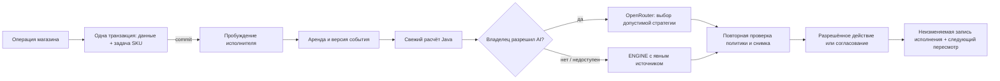

# ARIA Autonomous Platform — продолжение af2b115

Основной backend остаётся Java 21 / Spring Boot. Frontend сохраняет существующий HTML/JavaScript: перенос на React/Vue и отдельный ML-микросервис для этих задач не нужен. PostgreSQL V1–V16 не переписываются; V17 добавляет постоянные задачи/исполнения, V18 — сведения проверки хранения партий.

## Что выполняется без ежедневных кнопок

- Изменения карточки, цены, партии, отгрузки, возврата, предложения поставщика и импортированной котировки ставят SKU в постоянную очередь.
- Движок заново читает фактические данные, рассчитывает допустимые варианты, при разрешении обращается к OpenRouter и проверяет выбранную стратегию Java-ограничениями.
- При разрешённом AUTOPILOT применяются только допустимые AI-изменения цены с достаточной уверенностью, категорией, пределом скидки, минимумом и паузой. ENGINE и LOW не получают дополнительные права через новый оркестратор.
- Мониторятся сроки, объявленные условия хранения, остатки, динамика отгрузок и уже зарезервированные социальные товары. Завершённые/архивированные товары закрывают старые сигналы.
- По отдельному разрешению создаются внутренние черновики закупки и социальной помощи. Никакой внешней оплаты, заказа поставщику, автоматического резерва или фактической выдачи это не выполняет.
- Изменение политики владельца отзывает старую аренду и ставит активные SKU на свежую проверку; настройка сама запускает обработку, не требуя кнопки анализа. Следующая проверка решения сохраняется как `dueAt`. На работающем обычном сервере её обслуживает существующее расписание; на Free — запуск приложения, реальные события и активность API. Кнопка анализа остаётся диагностическим инструментом, не обязательной ежедневной процедурой.

## Надёжность очереди

`StoreChanged` публикуется внутри бизнес-транзакции. `ManagerDomainEvents.persist` в BEFORE_COMMIT вызывает REQUIRED `ManagerQueue.ensure`: намерение задачи и товарная операция сохраняются вместе. При rollback не остаётся ложной задачи. Только AFTER_COMMIT будит executor. Если процесс завершится после commit до пробуждения, задача уже находится в БД. Основание фаз: [официальная документация Spring](https://docs.spring.io/spring-framework/reference/data-access/transaction/event.html).

Уникальная задача на SKU дедуплицирует события. `generation` не теряет новое изменение во время обработки: старый исполнитель завершает свою запись, а новая версия остаётся в очереди. Короткие транзакции заявляют аренду; HTTP-вызов модели выполняется вне блокировок БД. Просроченная аренда восстанавливается; ответ старого исполнителя не завершает новую аренду. Автоматические ошибки повторяются с увеличением задержки, максимум три попытки; затем требуется исправление причины. Новый реальный event или аудируемый ручной повтор создаёт следующую версию. Отказ AI не задерживается до далёкого товарного горизонта: при доступной активности назначается более ранний контролируемый повтор, без платного fallback.

Пять минут аренды — техническая защита исполнителя, не срок годности и не горизонт спроса. Один цикл берёт до 50 задач и максимум одну AI-попытку. Повторы цен, закупок и социальных черновиков дополнительно ограничены существующими версиями/уникальностью/блокировками предметных сервисов. Emergency Stop проверяется также в момент применения цены и создания автоматического социального черновика, а не только при старте цикла.

## Отдельные временные величины

- **expiryDate** — фактическая дата партии, введённая по документам/упаковке. Категория не назначает дату.
- **Остаток срока** — календарная разница до этой даты, с включённым последним днём.
- **Покрытие запасом** — количество / наблюдаемая частота отгрузок. При отсутствии отгрузок неизвестно, а не ноль или бесконечный доказанный спрос.
- **Горизонт оценки** — ограничен доступной историей, её выборочной неопределённостью, покрытием и ближайшим фактическим сроком. Формула консервативная и явно эвристическая; она не является обученной моделью и не гарантирует спрос.
- **Следующий пересмотр** — отдельная доля временных границ, ограниченная техническим максимумом 72 часа и фактической ближайшей полуночью окончания годности. AI может выбрать целое число часов в допустимом диапазоне, но не продлить Java-дедлайн.

7/14/30 дней сохранены как отчётные окна фактических отгрузок. Они не назначают процент и не являются единым прогнозом. Движок рассматривает каждый допустимый целый процент от 0 до ограниченного максимума, а не таблицу с шагом 5%. LLM получает текущий/нулевой и лучшие рассчитанные варианты, затем проходит проверку исходного полного набора. Минимальная цена, закупка/маржа, доступность и запрет просрочки сохранены.

История учитывает реально записанную раннюю приёмку партии, даже если карточка SKU заведена позже. Это не доказывает полноту истории наличия: ограничение явно сохраняется. У нового товара с короткой историей длинный прогноз и эффект скидки не выдумываются; социальный риск за пределами поддержанного горизонта не объявляется доказанным. Старые сохранённые отчёты не переписываются и перед применением должны пройти новый актуальный расчёт.

## Прогноз и поставщики

`DemandForecast.fit(history,horizon)` использует выбранный срок поставки/покрытия, ограниченный фактической историей. Возвращает `expectedUnits` и `horizonDays`; старое JSON-поле `units14` заполняется только при действительно 14-дневном прогнозе. Скользящая средняя остаётся честным baseline. Ridge-модель допускается лишь при достаточности обучающей части и улучшении последовательного backtest; контрольные дни не используются для допуска модели к обучению. MAE — ошибка прогноза следующего дня, не доказанная точность всего будущего горизонта.

При неизвестном подтверждённом сроке поставки пополнение опирается на минимум владельца. Если весь срок поставки не покрыт данными, это отдельно указано. Сравнение действительных предложений учитывает стоимость всего минимального заказа, срок относительно оценочного покрытия и доступный дневной лимит. Дешёвая единица при огромном минимальном заказе не считается автоматически лучшим выбором. Черновик не создаёт обязательства и не меняет склад; реальная приёмка остаётся отдельной.

## Фактическая проверка хранения

Склад → партия → **Хранение**: требования из документов, UNKNOWN / CONFIRMED / REJECTED, подтверждение сотрудника и причина. Проверка защищена revision; хранится время и сотрудник. Старые партии получают UNKNOWN, не фиктивное подтверждение.

REJECTED исключает партию из пригодного остатка, продажи и передачи. Заявленные, но не подтверждённые условия блокируют автоматическое применение ценового решения; центр показывает исключение. Программа не измеряет температуру и не заменяет физическую оценку. Для социальной выдачи по-прежнему необходимы проверенная организация и явные подтверждения пригодности/транспорта.

## Новый Control Center

Домашний экран администратора теперь показывает: проверенные сегодня SKU, фактические автоматические изменения, созданные черновики, открытые исключения, постоянную очередь, ленту исполнений, источник решений и ссылки на конкретные сохранённые решения. Выручка отгрузок и оформленные потери не называются чистой прибылью. Результаты акций — наблюдаемые отгрузки при указанной длине периода, без обещания причинного uplift.

AI DECISION означает проверенное участие модели в выбранном решении. ENGINE DECISION — расчёт Java. AI UNAVAILABLE означает, что попытка не дала проверенного AI-результата; Java-расчёт не переименовывается в нейросеть. Если используется ранее сохранённый AI-выбор, это указано. Источник черновиков закупки/социальной помощи отделён от источника ценового решения; действия Java не приписываются модели.

Общая дизайн-система применена к витрине и административным формам: плотная навигация, единый акцент, контрастные статусы, типографика, таблицы, мобильное меню и светлая/тёмная темы. Изучены [Shopify](https://www.shopify.com/pos), [Stripe](https://stripe.com/payments), [Linear](https://linear.app/features) как ориентиры иерархии и состояния операций; страницы не копировались. Помощник доступен после каталога и по ссылке в первом экране, не перекрывает товары. Пустые/неполученные значения не заменяются выдуманными метриками.

Экран обновляет реально выполняющуюся работу ограниченное время при открытой вкладке; не опрашивает БД бесконечно ради удержания Free активным. При закрытой форме/возврате во вкладку данные можно перечитать. Это не Web Push.

## Первоначальные согласия и ручная ответственность

Один раз владелец задаёт границы Smart Pricing и согласованный состав данных OpenRouter, затем разрешает автоматические AI-запросы/типы черновиков в политике Manager. AUTOPILOT требует подтверждения актуальных границ и категорий. На стенде ключ читается сервером из исключённого `.env.openrouter.local`; его значение нигде не отображается и новые ключи не создаются. Платные модели и платный fallback не включаются.

Сотрудник подтверждает реальную приёмку, пригодность, неизвестное хранение, социальный резерв и фактическую выдачу. Внешние платежи/заказы/фискализация не интегрированы и не выполняются. Ключ OpenRouter не передаётся Poster/iiko/Kaspi. Доступы перечислены в [INTEGRATIONS_KZ.md](INTEGRATIONS_KZ.md).

## Free, публикация и оставшиеся границы

Во сне Render Free нет непрерывного исполнения. Startup/event/activity catch-up восстанавливает работу после пробуждения, без искусственных пингов. Возможный внешний планировщик — только отдельно разрешённый поставщик с подтверждённым бесплатным лимитом и безопасной серверной аутентификацией, вызывающий существующий административный запуск по бизнес-расписанию. Его учётные данные нельзя помещать в workflow/браузер/Git; такой сервис и расписание сейчас не создавались.

Kaspi seller API не считается API мониторинга. У Magnum/SMALL/Arbuz подтверждённый публичный мониторинговый API не найден в проверенных официальных материалах; CSV и существующие адаптеры продолжают работать. Никакого обхода ограничений. Реальные внешние кассы требуют отдельного разрешённого доступа и проверки сопоставления; до этого они явно не подключены.

PWA сохраняет только общую offline-страницу и иконку. API, личные данные и админка сервис-воркером не кэшируются; продажи офлайн не имитируются. Камера зависит от браузерной поддержки и разрешения; физические iOS/Android/сканер и публикация в магазинах приложений требуют отдельной проверки на реальном устройстве.

Preview и тесты изолированы от рабочего сайта. Production deploy, рабочий backup и переключение Neon/Render остаются отдельным согласованным этапом по [PLATFORM_READINESS.md](PLATFORM_READINESS.md). SQL проверяется локально, а не объявляется испытанным на рабочей Neon без запуска.
