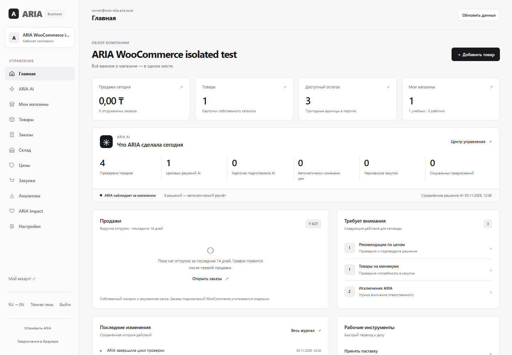

# ARIA: подключение магазина и безопасные цены

**Автономность 13.11:** [полная инструкция и проверенный сценарий](../aria4/AUTONOMY_RU.md). Настройка подключённого магазина теперь находится прямо в ARIA AI. Согласия модели, записи цен и осторожного эксперимента раздельные; по умолчанию автоматизация выключена. На выключенном/спящем сервере действий нет.

Новый вход в платформу: [заявка → отдельный кабинет → активация владельца](../onboarding/OWNER_GUIDE_RU.md). На 10.11 проверены отдельный портал 8088, новый кабинет 8089 и 276 тестов; новый кабинет пока пустой. Ниже сохранена инструкция прежней учебной WooCommerce-компании 8085, это другая БД и отдельные AI-согласия.

## Открыть проверенную версию

На этом компьютере: http://127.0.0.1:8085/control.html#stores. Вход владельца находится в локальном `data/woocommerce/aria-access.txt`. Настоящий изолированный WooCommerce: https://127.0.0.1:8449; его вход — `data/woocommerce/access.txt`.

Это отдельная учебная компания и отдельные базы. Товары, цены, закупочная себестоимость и заказы здесь учебные. Установка WordPress/WooCommerce и ответы его API настоящие. Доступ с телефона или другого компьютера по этим адресам невозможен. Production не обновлялся.

Отдельная клиентская витрина новой версии: http://127.0.0.1:8087/index.html. Вход владельца — `data/localization-preview/access.txt`, запуск — `scripts/localization/start-public-preview.ps1`. Здесь другая учебная база, без внешнего AI. В закрытой компании 8085 покупательская регистрация и публичный каталог намеренно недоступны.

Если среда выключена, из папки `backend` запустите `scripts/woocommerce/start-local.ps1`, затем `scripts/woocommerce/start-aria.ps1` через PowerShell. Существующие данные сохраняются. Не запускайте тестовые сценарии на рабочем магазине.

## Компания и магазины — разные вещи

Одну компанию обслуживает отдельный процесс ARIA с отдельной базой и привязкой. Теперь доступна регистрация-заявка и проверенная одноразовая активация отдельного локального кабинета; окружение по-прежнему готовит оператор. Автоматического облачного provision нет. Название в «Мои магазины → Компания» переименовывает текущий бизнес, а не создаёт новый.

После подготовки компании владелец входит в свой кабинет и подключает свои магазины. Нельзя объединять независимые компании в одном кабинете. Разделение проверено двумя процессами и двумя базами, даже с одинаковым email владельца и ключом подписи тестовых токенов.

Оператор подготавливает уникальную привязку компании, отдельную БД, ограниченную роль PostgreSQL, владельца, ключи подписи и шифрования доступов. Применяет миграции к новой пустой базе и проверяет привязку при запуске; затем выдаёт владельцу отдельный адрес кабинета и доступ защищённым способом. Нельзя переименовывать привязку заполненной базы. Скрипт публичной учебной витрины не предназначен для создания рабочей компании. Самостоятельный onboarding пока не предусмотрен.

Язык меняется кнопкой RU/EN в боковой панели; в магазине есть свой переключатель. Маршрут и вход сохраняются. Несохранённую форму нужно подтвердить. Названия, характеристики владельца и сохранённые AI-объяснения остаются исходными и не выдаются за проверенный перевод.

## Подключить свой WooCommerce

1. Откройте «Мои магазины» → «Подключить магазин» → WooCommerce.
2. Укажите понятное название и основной HTTPS-адрес магазина. Рабочий магазин не отмечайте тестовым.
3. В WooCommerce откройте «Настройки → Дополнительно → REST API». Создайте отдельный ключ с правом Read / Чтение. Введите оба значения непосредственно в защищённую форму ARIA.
4. Проверьте соединение. Если домен не одобрен, оператор должен добавить его в список разрешённых доменов сервера. Отправьте оператору только домен; ключи в чат не отправляйте.
5. Импортируйте каталог. Поддерживаются простые товары, варианты, цены и подтверждённая валюта. Неуправляемый или неизвестный остаток отображается как неизвестный, а не нулевой.
6. Откройте магазин → «Заказы» → обновите заказы. В ARIA сохраняются статус, даты и обезличенные позиции; контакты покупателей не копируются. Местный склад ARIA от такого импорта не списывается.

Повторный импорт обновляет существующие карточки и заказы без дублей. Текущий предел — 1000 карточек и 1000 заказов за полный импорт; превышение останавливает импорт и сохраняет прежний снимок. Это ограничение текущего коннектора, не поддержка магазинов любого размера.

Медленный ответ магазина не мешает отключить подключение или заменить ключи. Если за время чтения изменились доступы, задание или подтверждённая цена, ARIA сохраняет актуальные сведения и отбрасывает поздний ответ. В истории появится «Ответ не применён» с объяснением. После проверки подключения запустите обновление заново; повторный импорт не создаёт дубликаты. При сетевой ошибке прежний каталог остаётся доступен.

Для уведомлений откройте настройки магазина → «Уведомления». Включите приём, перенесите адреса и единожды показанную подпись в WooCommerce. Для реального внешнего магазина у ARIA должен быть публичный HTTPS-адрес. При архивировании/отключении ARIA отзывает локальные адреса; также выключите старые webhooks на стороне WooCommerce.

## Главная кабинета

Главная страница проверенной учебной компании; показатели отражают её учебную базу, а не продажи реального магазина:

## Характеристики собственного товара

Откройте «Товары → Изменить → Характеристики товара». Если уже меняли название, цену или бренд в общей форме, сначала сохраните их: переход в характеристики предлагает отказаться от несохранённых правок.

Укажите известные цвет, размер/упаковку и массу в килограммах. Неизвестные поля оставьте пустыми. Для другого коммерческого товара создайте отдельную карточку; исправление характеристики не меняет физический состав существующей партии. Производитель, состав, GTIN и сроки партии этим редактором не создаются.

Укажите основание, проверьте значения и подтвердите ввод. На витрине они обозначаются как сведения магазина. Пустая таблица не показывается. Если данные изменил другой сотрудник, старая форма не перезапишет их: откройте её заново. Изменения записываются в журнал; архивные товары защищены от правки.

Изменённая упаковка может перестать совпадать со справочником. Тогда прежние подтверждённые сведения больше не показываются, а справочное фото заменяется нейтральной заглушкой. Ваше собственное загруженное изображение этот редактор сохраняет. Изменение характеристик не списывает остаток и не меняет цену.

## Включить настоящий AI

Оператор безопасно задаёт `ARIA_OPENROUTER_API_KEY` и бесплатную модель, например `ARIA_OPENROUTER_MODEL=openrouter/free`. Ключ не вводится в товар, не показывается в ответах API и не попадает в Git. Бесплатный маршрут может быть недоступен или ограничен по квоте; платная замена не включается.

Владелец отдельно разрешает внешний AI в общих настройках цен, затем в «Мои магазины → магазин → Цены и ARIA → Разрешения и ограничения» подтверждает передачу данных конкретного магазина. Передаются название/SKU, цены, себестоимость, остатки и обезличенные позиции завершённых заказов. Контакты и ключи не передаются. Общий дневной лимит компании используется и для основного, и для подключённых каталогов.

Нажмите «Рассчитать рекомендации», затем «Запросить ARIA AI» у товара. Метка «Решение ARIA AI» появляется только после настоящего проверенного ответа модели. «Автоматический расчёт» означает Java-движок. Недоступность модели показывается отдельно и не считается AI-решением.

Проверенная модель учебного магазина: `nvidia/nemotron-3.5-super-vl:free`. Она выбрала KEEP — сохранить 1215 ₸: доступной истории мало. Это настоящий сохранённый ответ, а не автоматическое изменение цены. Подробности и ограничения доступны в карточке; итог виден также в ARIA AI.

## Уточнить сведения и разрешить изменение

В «Цены и ARIA» у товара нажмите «Подтвердить сведения». Укажите реальную себестоимость, минимум и категорию. Валюта и базовая цена фиксируются по текущему импорту. После смены валюты сведения требуется подтвердить заново. Сроки партий не придумываются.

Отмечайте отсутствие срока годности только у действительно бессрочного товара. Скоропортящийся внешний товар без подтверждённых партий не допускается к автоматической уценке. Эти сведения не создают местную складскую партию и не доказывают фактические условия хранения.

По умолчанию действует RECOMMEND: рекомендации подтверждает владелец. Разрешение записи — отдельное. Для неё потребуется WooCommerce-ключ Read/Write, сохранённый через настройки доступов. Замена ключей отзывает разрешения записи: проверьте соединение и разрешите изменения заново.

Новая цена проверяется по минимуму, себестоимости, максимальной скидке от подтверждённой базы, интервалу, текущей валюте, цене и остатку WooCommerce. Существующие акции не перезаписываются. После отправки ARIA повторно читает цену; только подтверждённый результат отмечается применённым.

## Автопилот

В разрешениях конкретного магазина отдельно включаются внешний AI, автоматический анализ, запись цен и режим AUTOPILOT. Явно перечислите категории, максимум скидки и интервал. Согласие на низкую уверенность означает эксперимент и по умолчанию выключено.

Сервер всё равно требует достаточной доступной истории: минимум 14 дней и 10 завершённых единиц для автоматического эксперимента. Это порог допуска, а не доказательство точного прогноза. Если модель просит подтверждение, выбирает KEEP, неизвестны партии/пригодность либо нарушены ограничения, цена автоматически не меняется.

После разрешённых обновлений каталога/заказов анализ может запускаться автоматически. Периодический таймер отдельно разрешается оператором через `ARIA_CONNECTED_PRICING_SCHEDULE_ENABLED=true`. На Free по умолчанию он выключен. Спящий или остановленный сервер не выполняет фоновых действий; работа 24/7 на Render Free не гарантируется.

Общая кнопка «Экстренная остановка» в ARIA AI запрещает будущие внешние AI-обращения и отключает запись/автоанализ подключённых магазинов. Уже отправленный запрос может завершиться: его результат нужно сверить отдельно. Автоматического обратного изменения внешней цены нет, чтобы не затереть последующую правку продавца.

## Если что-то пошло не так

- При ошибке импорта прежний каталог остаётся доступен. Очередь хранит ошибку и повтор; после устранения причины обновите подключение. Архивирование отменяет новые задания, сохраняя историю.
- Если отправка цены не подтверждена, не создавайте повторный запрос. Откройте историю и выберите сверку с WooCommerce через 30 секунд. Она читает результат без нового PUT.
- Если изменилась цена, валюта, остаток или разрешения, обновите каталог и пересчитайте рекомендацию.
- Перед публикацией оператор сохраняет резервную копию PostgreSQL и отдельно ключ шифрования доступов. Один dump без ключа не восстановит возможность использовать зашифрованные доступы.

Восстановление учебной V1–V32 проверяется `scripts/woocommerce/verify-restore.ps1`: новая база, проверка записей, запуск приложения, вход владельца и чтение истории. Production этот сценарий не использует.

## Что ещё не завершено

RU/EN проверены на 23 административных разделах и основных клиентских страницах, включая формы, ошибки и мобильные состояния. [Подробности и снимки](../localization/README_RU.md). Самостоятельная регистрация компаний, специальные характеристики всех товарных категорий и проверка магазина настоящего владельца остаются отдельными этапами. Внешний автопилот проверен тестовыми ответами провайдера на уровне серверных ограничений; живой OpenRouter выбрал KEEP. Нельзя выдавать это за автоматически проведённую моделью скидку.

Для рабочей публикации остаются отдельный публичный staging, реальный HTTPS-домен и ключи владельца, проверка его валюты/каталога/webhooks, резервная копия и явное разрешение на production deploy. Main и основной Render не переключались.

## Порядок безопасной публикации

1. Зафиксировать проверенный коммит рабочей ветки и успешный CI. Развернуть отдельный бесплатный staging с новой базой и отдельными секретами, не копируя контакты или доступы клиентов.
2. Проверить V1–V32 на пустой PostgreSQL и обновление отдельной восстановленной копии. Сверить привязку компании, права роли БД и отсутствие начальных демонстрационных пользователей.
3. На публичном HTTPS staging подключить разрешённый внешний тестовый WooCommerce с доступом только на чтение. Проверить импорт, повторный импорт, вариации, валюту, заказы, подписи уведомлений и восстановление очереди.
4. Владелец подтверждает фактические затраты, минимальные цены и отдельные согласия AI/записи. Начать с RECOMMEND. Проверить одно разрешённое изменение и фактическую цену в WooCommerce; не включать автопилот без достаточной истории и проверки границ.
5. Сохранить резервную копию PostgreSQL и ключ шифрования отдельными защищёнными средствами. Проверить восстановление, вход и чтение истории в новой среде. Старую рабочую базу не перезаписывать.
6. Подготовить предыдущий образ приложения и проверить совместимость отката со схемой. Не обещать откат БД, который удалит новые заказы. На случай сбоя остановить будущие автоматические действия и сверить отправленные изменения.
7. Получить отдельное разрешение владельца на конкретный production deploy. До него не менять main, основной Render и рабочую БД. В согласованное окно обновить приложение и выполнить короткую проверку входа, каталога, прав, очереди и журналов.
8. На Free учитывать сон сервера: фоновые задачи выполняются только при работающем процессе. Не обещать круглосуточную синхронизацию или AI. Платные ресурсы и автоматическое увеличение тарифа не создавать.
