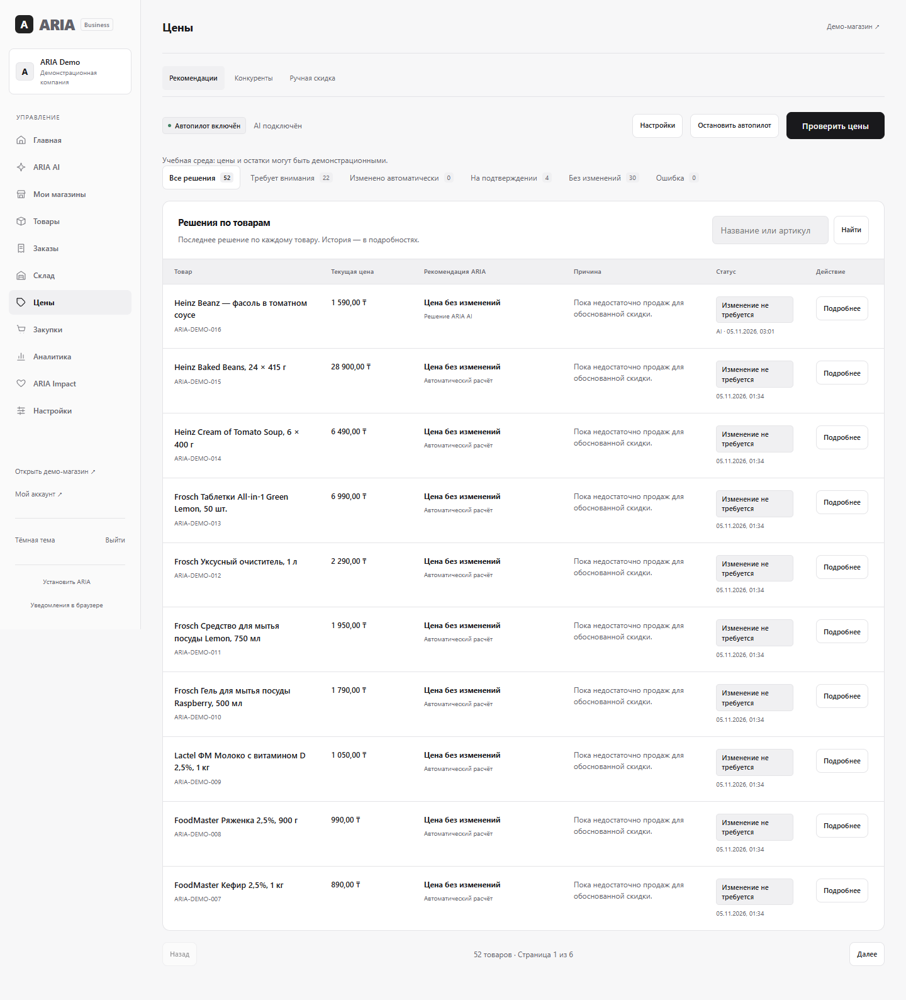
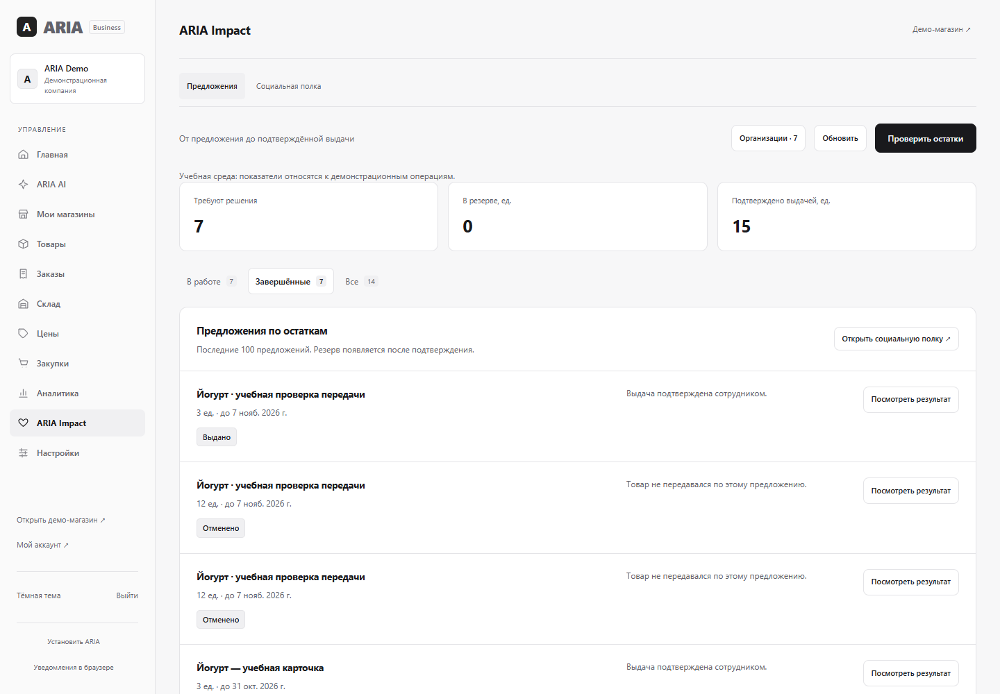
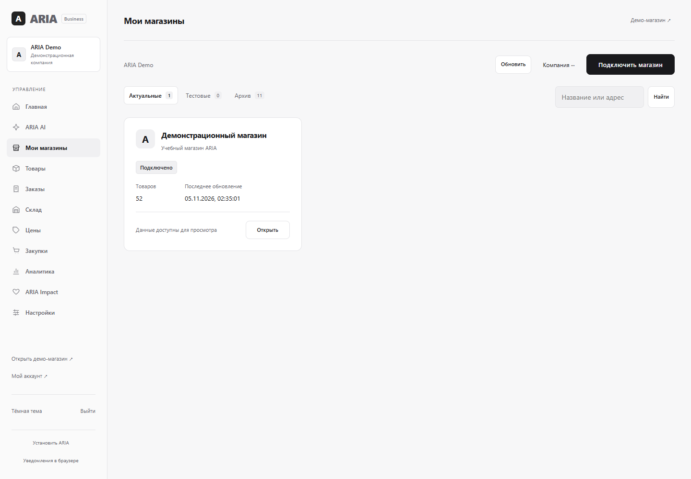

# Как открыть и проверить новую ARIA

Это отдельный локальный preview. Рабочий сайт Render и его база не переключались.

## Открыть

1. На этом компьютере откройте http://127.0.0.1:8084/control.html.
2. Данные владельца находятся в `backend/data/preview/access.txt`. Этот файл не отправляется в GitHub.
3. Выберите **Цены**, **ARIA Impact** или **Мои магазины** в боковом меню. На телефоне меню раскрывается кнопкой сверху.

Адрес `127.0.0.1` работает только на компьютере с запущенным preview. Это не публичная интернет-ссылка. Если preview остановлен, из папки `backend` запустите:

```powershell
powershell -NoProfile -ExecutionPolicy Bypass -File scripts/start-preview.ps1
```

Существующие данные и настройки сохраняются при повторном запуске.

## Цены

Открыть: http://127.0.0.1:8084/control.html#smart

- В списке — последнее решение по каждому товару. Поиск работает по названию и артикулу; фильтры показывают весь список, а не только текущую страницу.
- **Подробнее / Проверить решение** открывает исходные данные, ограничения, историю и действия.
- **AI: выбрать стратегию** действительно обращается к внешней модели при наличии согласия, ключа и оставшегося лимита. **AI-объяснение** объясняет расчёт отдельно от выбора решения.
- «Решение ARIA AI» означает участие модели в выборе. «Автоматический расчёт» означает Java Engine. Недоступность модели или пропуск запроса не превращаются в успешный AI-результат.
- «Цена без изменений» — нормальный результат. При недостатке подтверждённых продаж система не изображает доказанный эффект скидки.
- **Изменить → Сохранить** требует процент и причину. Сервер повторно проверяет цену, маржу, остатки и срок. После применения проверьте карточку на витрине. Откат доступен в подробностях применённого решения.
- **Обновить расчёт** появляется, когда исходные цена/остаток или время проверки изменились.

Режим показан сверху. В RECOMMEND изменение требует подтверждения. В AUTOPILOT явный анализ может применить разрешённые изменения; границы и экстренная остановка доступны рядом. Существующий режим владельца не сбрасывался.

Ключ задаётся на сервере через `ARIA_OPENROUTER_API_KEY`, отдельно от Git. Используется бесплатный маршрут `openrouter/free`; платное переключение запрещено. Согласия на внешнее решение, фоновый анализ и помощника покупателя сохраняются раздельно в настройках. Согласие покупателя также остаётся отдельным.

В **ARIA AI** обзор показывает сохранённые решения модели за день, включая ручные запуски. Автоизменения цен и черновики считаются отдельно. При недоступности данных отображается «—». Выключенный AI-менеджер не мешает разрешённому ручному запросу модели и не означает автоматическое изменение остальных настроек цен.



## Социальная полка и ARIA Impact

Владелец: http://127.0.0.1:8084/control.html#socialPlans

Организации и посетители: http://127.0.0.1:8084/social.html

1. Откройте предложение по риску непродажи. Если подходящих предложений нет, перейдите к проверке остатков.
2. В **Организации** проверьте условия приёма. На странице реестра `/admin.html` блок **Подключить фонд или приют → Создать доступ организации** создаёт учётную запись. После входа партнёр отправляет заявку, а владелец рассматривает её.
3. Проверьте пригодность товара, хранение, срок, категорию, регион и перевозку. Подтвердите резерв для подходящей проверенной организации.
4. Назначьте ответственного и время, подготовьте выдачу. До фактической передачи количество не списывается.
5. Организация скачивает акт из своих бронирований. Сотрудник сверяет подписи и факт получения.
6. Подтвердите фактическую выдачу. История и количество обновятся; CSV выданных товаров доступен во вкладке **Социальная полка**.

Черновик не резервирует товар. Просроченное предложение нужно закрыть и пересмотреть остатки. Проверку безопасности и подписи выполняет человек; ARIA не выдаёт их за измерение датчиком или внешнюю проверку реестра.

Публичная полка целиком переключает свои формы, статусы и ошибки RU/EN. Названия и исходные причины магазина сохраняются без автоматического перевода. При отсутствии товаров показано «Сейчас нет доступных предложений». Учебные операции помечены; проверка не является настоящей благотворительной передачей.



## Мои магазины

Открыть: http://127.0.0.1:8084/control.html#stores

В **Актуальных** находятся действующие подключения без тестовой отметки. У карточки одна кнопка **Открыть**. Каталог, заказы, история и настройка находятся внутри магазина.

**Подключить магазин** открывает шесть шагов: платформа → адрес → доступ → проверка → каталог → ARIA AI. Для WooCommerce создайте ключ с правом **Read / Чтение** по [официальной инструкции](https://woocommerce.com/document/woocommerce-rest-api/). Секрет сохраняется зашифрованным и не показывается повторно. Если доступ не прошёл проверку, мастер останавливается на ошибке, а не показывает готовое подключение.

На текущем этапе WooCommerce читает каталог, вариации и заказы в отдельное хранилище. Внешний каталог **ещё не передаётся автономному AI**, а запись внешних цен выключена. Шестой шаг прямо сообщает это ограничение. Настоящий установленный WooCommerce не был проверен этим preview: тестовые ответы и локальные подписи не считаются внешним E2E.

В **Настройках подключения** можно изменить название/тестовую отметку, настроить доступ и уведомления, отключить или архивировать магазин. Архив останавливает работу и сохраняет данные. Восстановление не включает уведомления и запись цен; сначала проверьте доступ. Удаление доступно только для отмеченного пустого тестового подключения в архиве — с подтверждением и повторной проверкой зависимостей на сервере. При наличии товаров, заказов, истории или заданий удаление блокируется.



## Что пока не завершено

Полная RU/EN-локализация административных модулей; административный помощник с безопасными действиями; расширенные схемы характеристик по категориям; самостоятельная регистрация новых компаний; установленный WooCommerce E2E и анализ/разрешённая запись цен его каталога. Большинство демонстрационных карточек пока используют подписанные placeholders: лицензированная фотография подтверждена только для одного товара.

Все новые проверки используют отдельные локальные базы или явно учебные операции. Университетский самоаудит остаётся отдельным снимком в `docs/rubezh2`; результаты чужого проекта не выдумывались.
