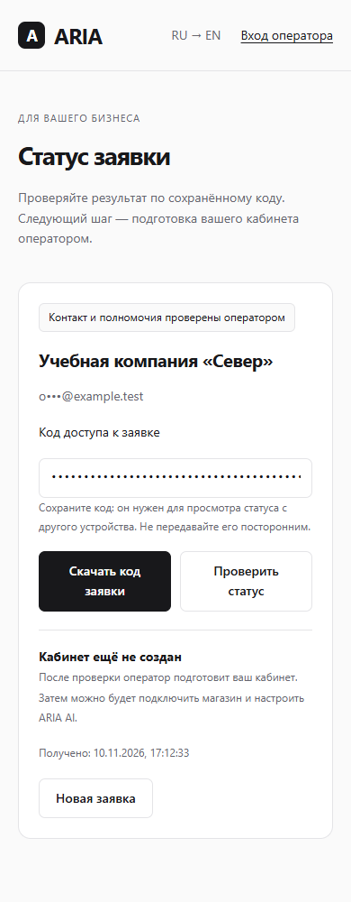
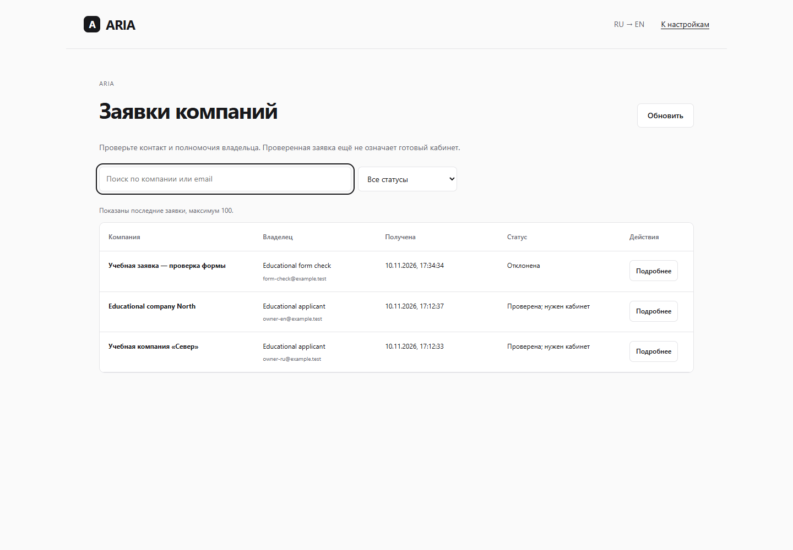

# Регистрация компании: заявка и проверка оператором

Это завершённый рабочий сценарий **регистрации-заявки**. Готовый кабинет компании и его активация — следующий этап. Интерфейс не называет заявку созданным аккаунтом и не предоставляет доступ к чужому магазину.

## Открыть

- Заявитель: [подать заявку](http://127.0.0.1:8088/company-start.html).
- Оператор: [проверить заявки](http://127.0.0.1:8088/company-requests.html). Вход — в исключённом из Git `backend/data/onboarding/registry-access.txt`.
- Запуск из `backend`: `powershell -NoProfile -ExecutionPolicy Bypass -File scripts/onboarding/start-local.ps1`. Перезапуск только этого процесса — `-Restart`; после готовой сборки можно добавить `-SkipBuild`.

Адреса локальные, доступны на этом компьютере. Это не публичный staging. Скрипт использует существующий локальный кластер 55434, но создаёт **отдельную БД и ограниченную роль `aria_registration_local`**, отдельный Java-процесс на 8088, привязку `aria-registration`. Другие базы и процессы не останавливаются и не переименовываются. Секреты находятся в `data/onboarding` с ограниченным доступом.

## Сценарий заявителя

1. Укажите компанию, имя и контактный email. Отдельно разрешите хранение данных заявки и контакт оператора для проверки. Пройдите арифметическую проверку.
2. Получите подтверждение сохранения. Скачайте код заявки: он позволяет проверить статус на другом устройстве. Код не является паролем кабинета.
3. Оператор берёт заявку на проверку, затем подтверждает контакт и полномочия либо отклоняет её с основанием. Автоматической проверки email и отправки писем нет.
4. Даже после проверки отображается «Кабинет ещё не создан». На этом этапе нет кнопки, объявляющей несуществующее окружение готовым.

Потеря ответа после сохранения не создаёт дубль при повторе с тем же кодом. Во время отправки блокируются конфликтующие действия формы; введённые поля сохраняются при сбое. Код хранится в сессии браузера и может быть скачан самим заявителем. В БД сохраняется только SHA-256 от криптографически случайного кода, не его исходное значение.

## Сценарий оператора

Войдите и откройте «Настройки → Заявки компаний» либо прямой адрес выше. Доступ проверяется сервером: нужен действующий ADMIN-токен именно отдельного процесса регистрации. Есть поиск, фильтр статусов, просмотр согласий, основание проверки, имя оператора, время и журнал действий. Устаревшее решение из другой вкладки получает 409 и не заменяет актуальное.

Контакт и полномочия проверяются оператором самостоятельно по надёжному каналу. Учебные отметки `example.test` в E2E проверяют работу интерфейса и сохранение ручного решения; они **не доказывают проверку настоящего email или реального предпринимателя**.

## Безопасность и архитектура

Существующая модель «компания = процесс + БД» сохранена. Публичная форма не создаёт Organization, пользователя, БД или сервер. Записи заявок находятся только в отдельном кабинете оператора; организация `aria-registration` обозначает этот кабинет, а не нового предпринимателя. На существующей бизнес-привязке включение сервиса запрещено при запуске.

По умолчанию функция выключена: `aria.company-signup.enabled=false`. Текущий двухфлаговый `/api/auth/capabilities` сохранён без изменений. Отдельный `/api/company-signup/capabilities` раскрывает только `enabled`; выключенный сервис не открывает транзакцию публичного запроса. Токен заявки не даёт прав оператора. API возвращают `no-store`; списки не содержат кодов или хешей. Невалидный/чужой код получает одинаковый 404. Действуют одноразовая CAPTCHA и ограниченные по памяти лимиты запросов на один процесс. Внешний AI для заявок не используется.

Исправлено существовавшее перенаправление после входа через `/\\foreign-host`: разрешены только безопасные относительные адреса того же сайта. Регрессия включена в CI (`check-login-redirect.cjs`).

## Проверки

- Полный серверный прогон: **259 тестов** на новой PostgreSQL, Flyway V1–V33, без падений/ошибок/пропусков. Предыдущие 249 сохранены отдельно; доказательство — `evidence/java-tests.json`.
- `application-e2e.json`: настоящий Java/HTTP/PostgreSQL, явные согласия, сохранение после потери транспортного ответа, повтор без дубля, восстановление в другом браузере, ручная проверка, реальный конфликт двух сессий. Аккаунты оператора не изменились; кабинет не объявлен готовым.
- `visual-check.json`: RU/EN на 360/390/768/1440 px, 16 видов; поиск/фильтры, отсутствие переполнения и непереведённых системных текстов. Реально подписанный токен с другим issuer отклоняется; корректность подписи сначала проверяется тем же ключом.
- `form-guard.json`: удержан реальный ответ сохранения, повторная отправка и конфликтующие действия блокируются. Только новая явно учебная заявка; после проверки она закрыта оператором.
- `persistence.json`: все заявки и решения сохранились после настоящего перезапуска JVM, аккаунт оператора не изменился.

Браузерные сценарии используют Edge и Playwright из `ARIA_PLAYWRIGHT_MODULE`. Они не предназначены для production. `application-e2e.cjs` создаёт только учебные заявки в указанной отдельной БД; `visual-check.cjs` читает сохранённые коды из частных E2E-файлов. Не переносить реальные коды/контакты в Git.

## Следующий шаг

Подготовка реального отдельного окружения оператором, проверка запущенного кабинета и одноразовая активация владельцем. До этого регистрация компании целиком не завершена. Точное продолжение — [NEXT_STEPS_RU.md](NEXT_STEPS_RU.md). Управление сотрудниками, положительный live-AUTOPILOT и обогащение импортированных карточек остаются следующими этапами; production не изменялся.
