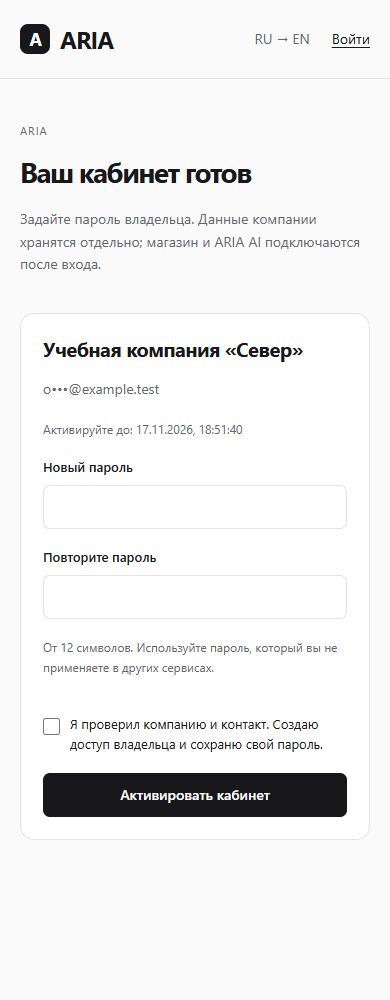
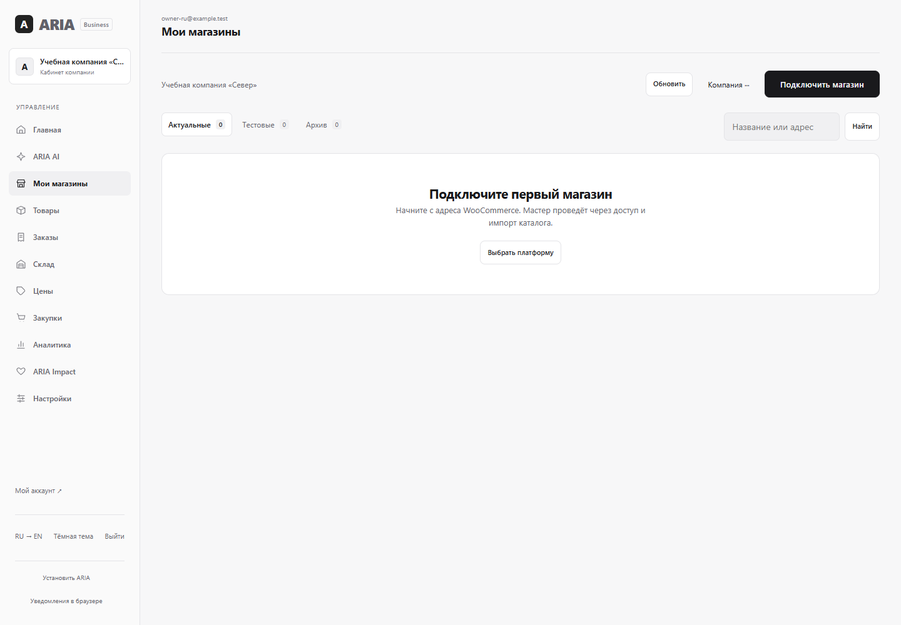

# Компания: заявка → отдельный кабинет → активация

**Публичный staging 13.11:** [открыть](https://aria-v4-staging-2ber.onrender.com/start.html), `backend/ARIA-Staging-preview.cmd`. Отдельные Render Free, Neon и секреты; main/production не менялись. Сборка `5190ce2`, CI и 8 онлайн-проверок успешны. [Подробно](../aria4/STAGING_RU.md).

**13.11, P5:** [проверенный автономный цикл WooCommerce](../aria4/AUTONOMY_RU.md), запуск `ARIA-AI-preview.cmd`. Реальная фоновая отправка 1500 → 1470 ₸ и readback; безопасный откат → 1500 ₸, история/пауза/экстренная остановка/восстановление расписания. 46 целевых сценариев; новый интерфейс проверен RU/EN, обе темы, 390/1440 px. Это локальный учебный E2E; отдельный публичный staging опубликован и проверен в P5.1.

Работают регистрация-заявка, ручная проверка, настоящее предоставление **отдельного локального окружения** и одноразовая активация владельцем. Создание облачных окружений и публичный staging пока не включены.

## Открыть

Обычный запуск — `ARIA.cmd`, подготовленная учебная компания — `ARIA-preview.cmd`, [новые товары ARIA 4.0](../aria4/PRODUCTS_RU.md) — `ARIA-Catalog-preview.cmd`. Файлы в папке проекта открывают отдельные локальные окружения, не обновляя production. Ручные команды ниже оставлены для диагностики.

- [Заявка и статус](http://127.0.0.1:8088/company-start.html).
- [Оператор](http://127.0.0.1:8088/company-requests.html); локальный вход в исключённом из Git `data/onboarding/registry-access.txt`.
- [Новый учебный кабинет](http://127.0.0.1:8089/control.html#stores). Команда `node scripts/onboarding/open-owner-preview.cjs` открывает отдельное окно и входит через настоящий интерфейс без вывода пароля.

Это адреса на данном компьютере, не онлайн-preview. Запуск — [OWNER_GUIDE_RU.md](OWNER_GUIDE_RU.md).

## Рабочий сценарий

1. Компания/контакт, два отдельных согласия, CAPTCHA, скачивание кода. В БД только SHA-256 кода; повтор после потери ответа не создаёт дубль.
2. Оператор самостоятельно проверяет контакт и полномочия, сохраняет основание. Автоматических писем и проверки настоящего email нет; `example.test` в E2E — учебные контакты.
3. VERIFIED → «Подготовить кабинет» → PREPARING. HTTP-ответ содержит только id/status/version/serverSetupPrepared, без настроек и секретов.
4. Локальная операторская команда читает шифрованный ключ непосредственно из частной БД. Создаёт отдельную ограниченную роль/БД `aria_onboarding_shop` и Java-процесс 8089. Заполненную компанию не переименовывает; веб-приложение не получает права создавать базы.
5. «Проверить готовность»: подписанный ответ именно этого процесса, случайный nonce, заявка, привязка компании, хеш контакта и срок. Только затем READY и ссылка владельцу.
6. Владелец выбирает пароль по сохранённому коду. Фрагмент ссылки сразу убирается из адреса; код передаётся заголовком. До активации запрещены вход с подготовительным паролем и бизнес-API даже с корректно подписанным токеном.
7. Пароль bcrypt, старые токены отозваны. Повтор кода не меняет пароль. Вход в собственный пустой «Мои магазины», проверка портала показывает ACTIVE. Магазины и AI-согласия автоматически не включаются.

## Безопасность

Архитектура «компания = процесс + БД» сохранена. Портал: `aria_registration_local`/binding `aria-registration`; кабинет: новая БД/роль и `business-…`. Роли не superuser, не создают базы/роли и не имеют CONNECT к другим компаниям. Существующие учебные и production-базы этим этапом не изменялись.

Новые сервисы по умолчанию выключены. Probe разрешает только `http://127.0.0.1:8089`, профиль `local-onboarding`, точную локальную БД портала и loopback; production запрещён. Без redirects/proxy; таймаут и предел ответа 8 КБ. Штатный запрос: id + nonce + HMAC, без секрета, email, пароля или кода владельца. Сеть вне транзакции, затем повторная проверка версии. Новый процесс проверяет фактическую БД/роль, маркер оператора, владельца и пустоту неактивированного кабинета; публично маркер не создаётся.

`data/onboarding` закрыта ACL и исключена из Git. Настройки нового кабинета и повторяемый учебный пароль зашифрованы AES-GCM; открытый пароль не записывается в файл/API. Ключ шифрования нужно хранить отдельно от дампа. API no-store, коды маскируются, неверные попытки ограничены по памяти одного процесса. Обрабатывается новая ссылка в той же вкладке; поздний ответ не заменяет новый экран. Старый `/api/auth/capabilities` не менялся.

## Доказательства

- **276** тестов полного прогона на свежей PostgreSQL, Flyway V1–V34, validate: 0 failures/errors/skipped. `evidence/java-tests.json`. GitHub проверяет H2 и отдельный PostgreSQL-набор.
- `activation-e2e.json`: реальные браузер/Java/БД, отказ готовности остановленного сервера, подписанный ответ, активация/вход, replay, чужие JWT, отзыв версии, изоляция ролей, настоящий рестарт с сохранением пароля/маркера. Исходный отрицательный тест передавал ключ только локальному тестовому endpoint для проверки отказа; текущий скрипт использует случайную неверную подпись и вообще не передаёт ключ.
- `activation-visual.json`: **48 видов** RU/EN × 360/390/768/1440: статус, оператор, ввод/ошибка кода, активированный кабинет, «Мои магазины»; без JS-ошибок/переполнения/непереведённых системных текстов, reduced motion. Новый пароль проверен в первом реальном RU E2E. Новая EN-активация второго владельца не выполнялась.
- Старые доказательства этапа 1а (259 тестов, форма/потеря ответа/восстановление, конфликт сессий, 16 видов, рестарт) сохранены как история. Прежние 194 посещения всей платформы этим этапом заново не выполнялись.
- Словарь: 1837 ключей, 48 скриптов; проверки копий и безопасного возврата после входа проходят.

## Реальное восстановление

`node scripts/onboarding/verify-recovery.cjs` использует существующие `backup-postgres.ps1` / `restore-postgres.ps1`: два настоящих дампа в закрытой `data/onboarding/recovery`, SHA-256, новые случайные БД/ограниченные роли, транзакционное восстановление без `--clean`. Проверены отказ при неверной контрольной сумме и повторная запись поверх заполненной копии. Совпали хеши записей компании, пользователей, заявок, активации, журнала, каталога и исходных данных до/после.

Оба восстановленных приложения запускаются под новыми ограниченными владельцами. Проверены настоящий вход оператора/владельца, прежний код заявки, ACTIVE, расшифровка настроек отдельно сохранённым ключом, подписанная аттестация и браузер 390/1440 px **из упакованного JAR**. Временные процессы 8090/8091 остановлены; основные 8088/8089 сохраняются. `evidence/recovery-v34.json`; дампы/секреты не в Git. Это локальная проверка учебных компаний, не внешнее защищённое хранилище или автоматический disaster recovery в облаке.

## Ограничения

Поддерживается один новый локальный учебный кабинет. Вторая заявка не получает чужую БД. Перевыпуск/отзыв истёкшей активации, сотрудники OWNER/ADMIN/MANAGER/WAREHOUSE, положительный live-AUTOPILOT и внешний магазин предпринимателя остаются в плане. OpenRouter этого этапа не вызывался, новые AI-согласия не выставлялись.

Произвольные внешние адреса и выдачу секрета через операторский API отклонила автопроверка безопасности; этот путь удалён. Для онлайн-provision нужен конкретный согласованный адрес и защищённая серверная настройка. Не обходить локальное ограничение. [Точная точка продолжения](NEXT_STEPS_RU.md).
