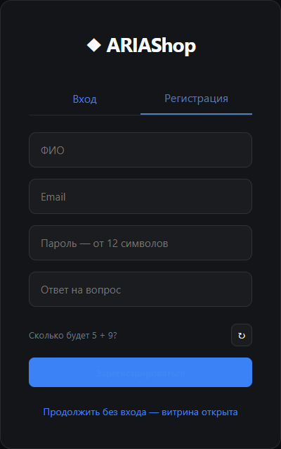
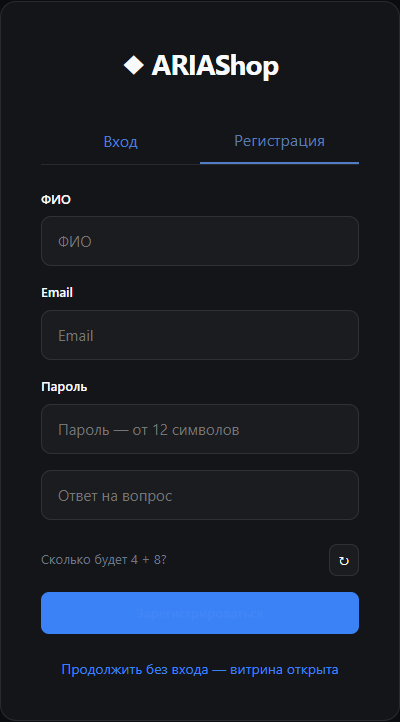
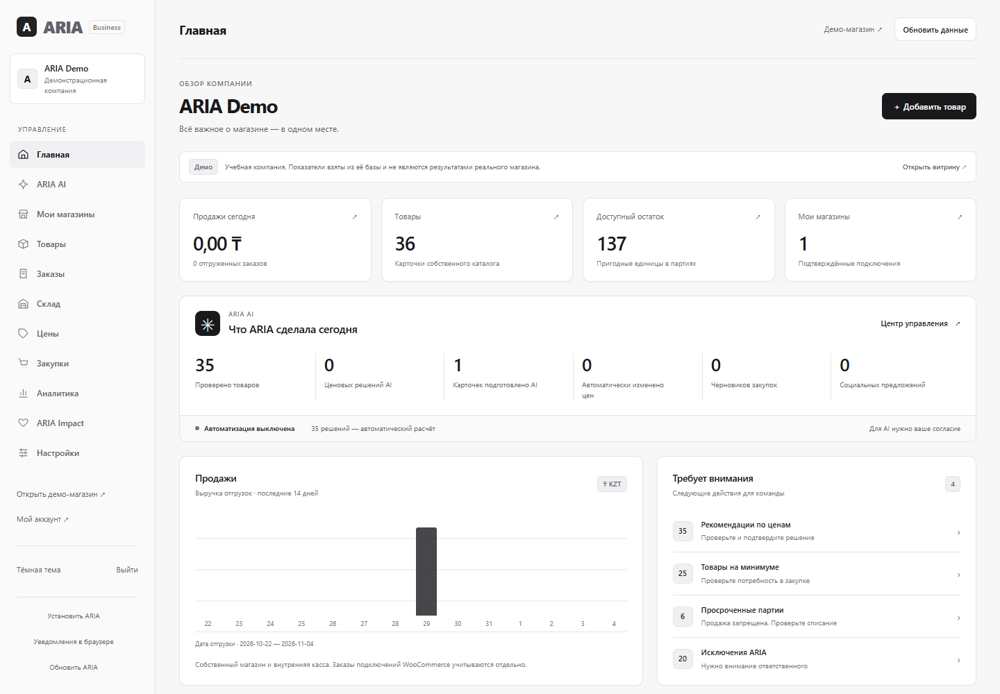
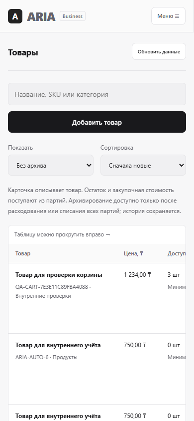
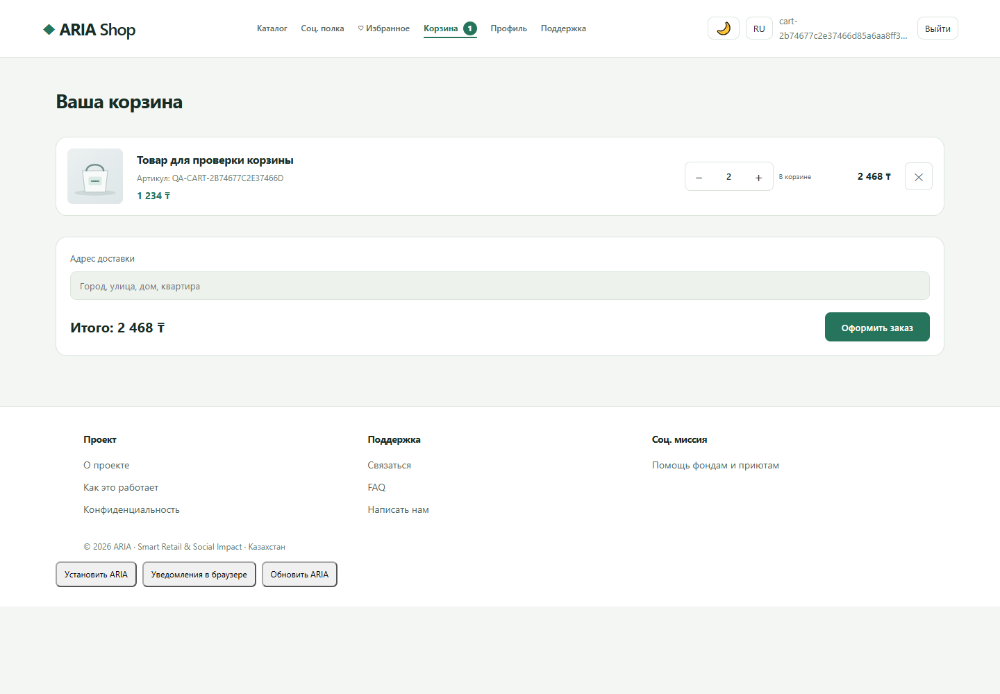

# Самопроверка проекта ARIA

Отчёт по II рубежному контролю

ФИО ____________________

Группа ____________________

Преподаватель ____________________

2026

## 1 Цель работы

Выполнить самопроверку собственного проекта ARIA по критериям II рубежного контроля: проверить Frontend и Backend, сохранить доказательства, внести обоснованные исправления и подтвердить их повторными проверками.

Проверенная версия исходного кода — a054298, ветка codex/production-foundation. Контрольная дата — 4 ноября 2026 года. Выполнено 12 Frontend- и 15 Backend-проверок локального контракта; все 27 пройдены. Отдельный живой AI-сценарий не пройден из-за ограничения внешнего бесплатного провайдера.

## 2 Краткое описание проекта ARIA

**Проблема.** Владельцу магазина приходится сопоставлять продажи, остатки, сроки и цены в разных инструментах. Разрозненные данные затрудняют своевременное решение о пополнении, скидке или передаче пригодного излишка.

**Цель.** Объединить учёт и поддержку решений в одной платформе ARIA, сохранив проверку ограничений, права пользователей и прослеживаемость операций.

**Пользователи.** Владельцы и сотрудники магазинов используют административную панель. Покупатели работают с демонстрационной витриной. Проверенные социальные организации участвуют в согласованной передаче товаров.

**Основные функции.** Каталог, партии, заказы, корзина, внутренняя касса, закупочные черновики, ценовые рекомендации, импорт цен конкурентов, социальные предложения и подключения магазинов. WooCommerce читает внешний каталог и заказы в отдельные снимки; запись во внешний магазин не включена.

**Взаимодействие Frontend и Backend.** HTML, CSS и JavaScript формируют страницы. Fetch API передаёт запросы REST в Spring Boot. Контроллеры проверяют доступ и входные данные, сервисы выполняют бизнес-операции, JPA сохраняет состояние в PostgreSQL.

**Особенность решения.** Java рассчитывает допустимые сценарии, а нейросеть может участвовать в выборе или объяснении. Ответ модели проходит серверную проверку. Источники AI и автоматического расчёта различаются; нейросеть не исполняет произвольный SQL и не меняет цены напрямую.

**Практическая значимость.** Единая история партий, цен и операций помогает проверять причины управленческих решений. Снижение потерь или рост прибыли в реальном магазине в этой работе не измерялись.

**Логика работы.** Карточка товара → приёмка партии → анализ доступных данных → рекомендация → подтверждение либо разрешённое действие в границах → учёт продажи или социальной выдачи. Демонстрационная витрина использует то же бизнес-ядро, но её учебные значения не являются рыночными наблюдениями.

## 3 Архитектура Frontend и Backend

| Компонент | Технологии | Ответственность |
| --- | --- | --- |
| Frontend | HTML5, CSS3, JavaScript, Fetch API, PWA | Витрина и административная панель; клиент не заменяет серверную авторизацию |
| Backend | Java 21, Spring Boot 4.1.1, Spring Security | REST, DTO, Bean Validation, сервисы и централизованные ошибки |
| Данные | PostgreSQL, JPA/Hibernate, Flyway V1–V27 | Товары, партии, поставщики, заказы, решения, журналы и интеграции |
| AI | OpenRouter, только бесплатные модели | Структурированный ответ с ограниченными вариантами и отдельными согласиями |
| B2B | Отдельная база и процесс на организацию | Привязка JWT к организации; импортированные снимки отделены от местного склада |

Используется разделение Controller → Service → Repository. Репозитории инкапсулируют работу с сущностями. Сервисный слой координирует ограничения и транзакции. Покупательская роль USER и административная ADMIN проверены фактическими API-запросами; интерфейсное скрытие меню не считается защитой данных.

## 4 Методика тестирования

Проверки выполнялись на http://127.0.0.1:8084 с отдельной PostgreSQL на порту 55434. Новые записи HTTP-аудита имели учебные названия и не описывают реальную поставку. В этом сценарии партии списаны с причиной, карточки архивированы; история сохранена.

Основной браузер — Edge 156.0.4314.58; дополнительная проверка — Chrome 156.0.8078.80. Ширины — 390 и 1440 px. Ожидание ответа и отказ 503 для интерфейса моделировались явно; успешные запросы затем направлялись в реальный Backend. Подмена ответа не использовалась как доказательство успешной работы AI.

Сохранённый полный PostgreSQL-прогон JUnit содержит 182 теста: ошибок 0, отказов 0, пропусков 0. Он повторно не запускался без изменения Java-кода. Текущий HTTP-аудит, браузерные проверки, проверка двух организаций и сохранности после перезапуска учитываются отдельно; их количества не суммируются с JUnit как уникальные тесты.

Локальная прогретая главная загрузилась до проверяемого содержимого за 288 мс в одном наблюдении. Это измерение конкретного стенда, а не SLA Render Free или нагрузочный тест.

## 5 Аудит Frontend

Проверены регистрационная форма, отказ входа, административная навигация, главная, мобильный экран, поиск, пустые состояния, ожидание ответа и обработка ошибки. Главная показывает сохранённые данные; действия модели отделены от автоматического расчёта. Видимые подписи полей, пределы ввода и общий контроль количества уменьшают неоднозначность действий пользователя.

Выборочные значения контраста установившегося интерфейса лежат в диапазоне 4.51–16.74 к 1. Проверены 10 внутренних ссылок витрины; каждая вернула HTTP 200. При измерении отключались переходные анимации, чтобы не измерять промежуточный кадр смены темы.

## 6 Таблица Frontend тестов

| № | Раздел | Проверяемая функция | Предусловие | Выполненные действия | Ожидаемый результат | Фактический результат | Статус | Доказательство | Предложение |
| --- | --- | --- | --- | --- | --- | --- | --- | --- | --- |
| FE01 | Frontend | Некорректный email | Открыта регистрация | Ввести неверный email и нажать регистрацию | Форма блокируется до отправки | Email отклонён встроенной валидацией; POST не отправлен. Скриншот FE01.png. | Пройден | [Открыть](EVIDENCE/FE01.json) | Сохранять тип email и серверную проверку |
| FE02 | Frontend | Обязательное поле | Открыта регистрация | Оставить ФИО пустым и нажать регистрацию | Пустое поле отклоняется | Форма не отправлена; поле ФИО имеет valueMissing. FE02.png. | Пройден | [Открыть](EVIDENCE/FE02.json) | Сохранить регрессионную проверку |
| FE03 | Frontend | Неверный пароль | Пользователь не вошёл | Отправить неверные учётные данные | Понятная ошибка без входа | HTTP 401; сообщение: Неверный email или пароль. FE03.png. | Пройден | [Открыть](EVIDENCE/FE03.json) | Сохранить регрессионную проверку |
| FE04 | Frontend | Меню и данные главной | Владелец авторизован | Открыть главную и настройки | 11 разделов; счётчики совпадают с API | 11 разделов, 8 переходов настроек, фактические счётчики API совпали. FE04.png. | Пройден | [Открыть](EVIDENCE/FE04.json) | Сохранять единую навигацию и реальные показатели |
| FE05 | Frontend | Мобильный интерфейс | Владелец авторизован | Открыть меню и товары при ширине 390 px | Меню доступно; страница не шире экрана | Меню и таблица доступны; глобального горизонтального выхода нет. FE05.png. | Пройден | [Открыть](EVIDENCE/FE05.json) | Проверять мобильные формы при изменениях |
| FE06 | Frontend | Ожидание данных | Задержан один GET главной | Задержать ответ и затем пропустить реальный запрос | Видно ожидание, затем данные | При искусственной задержке виден текст ожидания; после реального ответа появляется главная. FE06.png. | Пройден | [Открыть](EVIDENCE/FE06.json) | Сохранить регрессионную проверку |
| FE07 | Frontend | Ошибка Backend и повтор | Смоделирован ответ 503 | Обновить главную; затем убрать сбой и повторить | Ошибка понятна; повтор восстанавливает экран | Смоделированный 503 показан без ложных данных; повторный реальный GET успешен. FE07.png. | Пройден | [Открыть](EVIDENCE/FE07.json) | Сохранить регрессионную проверку |
| FE08 | Frontend | Пустой результат и длинный ввод | Открыта демонстрационная витрина | Искать отсутствующий товар; ввести 2000 символов | Пустое состояние без сбоя страницы | Поиск сообщает «Ничего не найдено»; длинный ввод ограничен 200 символами, без сбоя или выхода страницы. FE08.png. | Пройден | [Открыть](EVIDENCE/FE08.json) | Ограничить длину поискового запроса по единому правилу |
| FE09 | Frontend | Создание и повторная отправка | Открыт мастер товара без внешнего AI | Заполнить карточку и отправить форму дважды | Создаётся одна карточка с Java SKU | Один POST вместо двух; ARIA-AUTO-7, остаток 0. FE09.png. | Пройден | [Открыть](EVIDENCE/FE09.json) | Сохранять блокировку повторной отправки |
| FE10 | Frontend | Постоянные подписи полей | Открыт вход и регистрация | Проверить видимые label у обязательных полей | У 5 полей есть видимые подписи | Пять обязательных полей сохраняют видимые подписи после ввода. FE10.png. | Пройден | [Открыть](EVIDENCE/FE10.json) | Добавить постоянные label и доступные сообщения ошибок |
| FE11 | Frontend | Разные браузеры | Установлены Chrome и Edge | Открыть витрину при 1440 и 390 px | Страницы работают в двух браузерах | Edge 156.0.4314.58 и Chrome 156.0.8078.80; обе ширины без глобального выхода. Разные движки не проверялись. | Пройден | [Открыть](EVIDENCE/FE11.json) | Сохранить регрессионную проверку |
| FE12 | Frontend | Контраст и ссылки | Открыта главная в двух темах | Измерить 5 текстовых стилей в каждой теме; открыть внутренние ссылки | Контраст не ниже 4,5 к 1; ссылки возвращают 200 | 10 установившихся значений контраста, минимум 4.51; 10 ссылок HTTP 200. Полный WCAG-аудит не заявляется. | Пройден | [Открыть](EVIDENCE/visual-review.json) | Повторять выборочные измерения после изменений цветов |

## 7 Аудит Backend

Проверены создание, чтение, изменение и удаление ресурсов, обязательные поля, формат цены, дубли SKU, отсутствующие объекты, регистрация, разграничение ролей, конкурентное изменение корзины и защита чужих данных. Для товара удаление означает архивирование, для партии — списание; такие операции сохраняют историю.

Изоляция организаций проверена двумя реальными Spring Boot-процессами, двумя PostgreSQL-базами и ограниченными логинами БД. Email владельца и ключ подписи JWT намеренно совпадали. Чужие токены были отклонены, одинаковый SKU не смешивал данные, изменение AI-согласия в компании A не изменило компанию B. Проверено наличие V27 в обеих базах; внешних AI-запросов этот сценарий не делал.

## 8 Таблица Backend тестов

| № | Раздел | Проверяемая функция | Предусловие | Выполненные действия | Ожидаемый результат | Фактический результат | Статус | Доказательство | Предложение |
| --- | --- | --- | --- | --- | --- | --- | --- | --- | --- |
| BE01 | Backend | Защищённый API без токена | Запрос без авторизации | GET /api/admin/control/products | HTTP 401 | HTTP 401; список товаров администратора не выдан. | Пройден | [Открыть](EVIDENCE/BE01.json) | Сохранить регрессионную проверку |
| BE02 | Backend | Недействительный токен | Подпись токена недействительна | GET с поддельным Bearer | HTTP 401 | HTTP 401; доступ отклонён. | Пройден | [Открыть](EVIDENCE/BE02.json) | Сохранить регрессионную проверку |
| BE03 | Backend | Отсутствующие поля | Владелец авторизован | POST корректных типов без обязательного названия | HTTP 400 с ошибками полей | HTTP 400, «Проверьте поля формы»; name присутствует в fields. | Пройден | [Открыть](EVIDENCE/BE03.json) | Сохранить регрессионную проверку |
| BE04 | Backend | Неверный формат цены | Владелец авторизован | POST с текстом вместо цены | HTTP 400 без stack trace | HTTP 400, «Неверный формат значения или даты»; стек не раскрыт. | Пройден | [Открыть](EVIDENCE/BE04.json) | Сохранить регрессионную проверку |
| BE05 | Backend | Создание и чтение товара | Корректный объект | POST product, затем GET по ID | Данные сохраняются без подмены | POST 200 и GET 200; SKU и название совпали, id 44. | Пройден | [Открыть](EVIDENCE/BE05.json) | Сохранить регрессионную проверку |
| BE06 | Backend | Дублирующийся SKU | Товар BE05 существует | Повторить POST с тем же SKU | HTTP 409 без второй записи | HTTP 409: SKU уже занят другим товаром | Пройден | [Открыть](EVIDENCE/BE06.json) | Сохранить регрессионную проверку |
| BE07 | Backend | Обновление товара | Существует товар BE05 | PUT цены 1100 и GET | Цена изменена на 1100 | PUT 200; повторный GET вернул цену 1100. | Пройден | [Открыть](EVIDENCE/BE07.json) | Сохранить регрессионную проверку |
| BE08 | Backend | Несуществующий ресурс | ID отсутствует в стенде | GET, PUT и DELETE product по отсутствующему ID | Все операции возвращают 404 | GET, PUT, DELETE: HTTP 404, «Товар не найден». | Пройден | [Открыть](EVIDENCE/BE08.json) | Сохранить регрессионную проверку |
| BE09 | Backend | CRUD поставщика | Связанных партий у нового поставщика нет | Создать, прочитать, изменить и удалить | 200 для CRUD, затем GET 404 | Создание, чтение, изменение и удаление: 200; после удаления 404. | Пройден | [Открыть](EVIDENCE/BE09.json) | Сохранить регрессионную проверку |
| BE10 | Backend | Партия и связь с товаром | Товар BE05 без запаса | Принять 2 учебные единицы; изменить номер партии | Остаток 2; связь с товаром сохранена | POST/GET/PUT партии 200; пригодный остаток товара 2. Партия учебная, не реальная поставка. | Пройден | [Открыть](EVIDENCE/BE10.json) | Сохранить регрессионную проверку |
| BE11 | Backend | Регистрация и роли | Получены одноразовые задания капчи | Зарегистрировать двух QA покупателей; запросить admin API | Регистрация 200 с ролью USER; admin API 403 | Две регистрации 200, роли USER. Покупателю admin API вернул 403. | Пройден | [Открыть](EVIDENCE/BE11.json) | Сохранить регрессионную проверку |
| BE12 | Backend | Конкурентная корзина и чужие данные | Два QA покупателя и 2 единицы | Два одновременных добавления; чужой PUT по ID позиции | Одна строка qty 2; чужое изменение отклонено | Два POST 200 → одна строка qty 2. Чужой PUT 400; исходная корзина не изменена. | Пройден | [Открыть](EVIDENCE/BE12.json) | Сохранять блокировку владельца перед изменениями |
| BE13 | Backend | Удаление с сохранением истории | Есть учебная партия товара | Архивировать с запасом; списать партию; повторить архивирование | 409 до списания; 200 после, история остаётся | Защита 409 с запасом; списание и архивирование 200. История партии доступна, товар archived=true. | Пройден | [Открыть](EVIDENCE/BE13.json) | Сохранить регрессионную проверку |
| BE14 | Backend | Конфиденциальность AI | Владелец читает настройки | GET настроек; проверить отсутствие ключей и токенов | В ответе только безопасные метаданные | HTTP 200; key/apiKey/пароли не выдаются; textOnly=true, лимит 5. Внешний AI не вызывался. | Пройден | [Открыть](EVIDENCE/BE14.json) | Сохранить регрессионную проверку |
| BE15 | Backend | Изоляция организаций | Две пустые БД и два процесса с одинаковыми email и ключом подписи | Один SKU в обеих компаниях; чужие JWT; изменение согласия в A | Данные разделены; чужие токены 401; согласие B не меняется | Проверено двумя реальными процессами и ограниченными PostgreSQL-ролями; V1–V27 применены. | Пройден | [Открыть](EVIDENCE/organization-isolation.json) | Проверять границу при изменениях моделей и API |
| EXT01 | Backend | Живой AI черновик после усиления защиты | Бесплатная модель и отдельное согласие на текст | Запросить черновик через реальный интерфейс | Безопасный ответ модели, проверка владельцем, сохранённая карточка | OpenRouter вернул 429, приложение отклонило генерацию. Локальные 5 попыток исчерпаны. Финальный живой сценарий не завершён. | Не пройден | [Открыть](EVIDENCE/ai-live-limit.json) | Повторить после восстановления бесплатного лимита без обхода проверок |

## 9 Выявленные недостатки

Новым подтверждённым замечанием к форме стали отсутствующие постоянные подписи пяти обязательных полей. До исправления FE10 обнаружил 0 подписей из 5. Отдельно выявлены риски повторных операций корзины, небезопасной старой внутренней очистки и неподтверждённых сведений в AI-тексте. Ниже указаны исправления и соответствующие доказательства.

Два начальных расхождения Backend относились к тестовому сценарию: пустой объект уже возвращал 400 на стадии разбора, а SKU штатно переводился в верхний регистр. Исправлены ожидания теста, а не объявлены несуществующие дефекты приложения. Также уточнены ожидание асинхронного CHECK, начальный about:blank в браузерном тесте и измерение контраста после анимации.

## 10 Предложения по улучшению

| Код | Слой | Основание | Конкретное изменение | Проверка |
| --- | --- | --- | --- | --- |
| F1 | Frontend | У полей входа и регистрации не было постоянных подписей | Добавлены label, autocomplete, пределы длины и role=alert | FE10 до: 0 из 5; после: 5 из 5 |
| F2 | Frontend | Повторное добавление не давало согласованного управления количеством | Общее серверное состояние, кнопки плюс/минус, защита повторов и обновление вкладок | cart-report.json; 8 быстрых нажатий, одна позиция |
| F3 | Frontend | Сложная навигация и главная с преобладанием подключений | 11 основных разделов, связанные вкладки, реальные показатели и задачи | FE04, FE05; workspace-report.json |
| F4 | Frontend | Длина поискового ввода не была ограничена | maxlength=200 и доступное имя поля поиска | FE08; улучшение устойчивости, не воспроизведённый сбой |
| B1 | Backend | Первое добавление в корзину не блокировало владельца и товар | Порядок блокировок владелец → товары; согласован с оформлением заказа | BE12; тест конкурентных добавлений и checkout |
| B2 | Backend | Устаревший внутренний checkout() очищал общую таблицу корзин | Очистка ограничена LEGACY_OWNER, действия текущего API ограничены владельцем | CartServiceTest; чужие записи сохранены. Риск внутреннего метода, не открытый HTTP-доступ |
| B3 | Backend | Модель добавила неподтверждённый состав по одному названию | Названия, нейтральные описания и вопросы ограничены сервером; отзыв согласия и подтверждение проверяются | ProductDraftModelServiceTest, ProductCreationIntegrationTest; живой финальный сценарий заблокирован 429 |
| B4 | Backend | Ошибка провайдера внутри HTTP 200 могла выглядеть как ошибка формата | Разбирается error, сохраняется безопасный код отказа; ложного AI-результата нет | IntelligenceServiceTest, ProductDraftModelServiceTest |
| B5 | Backend | Свежий AI-ответ по старой рекомендации мог не попадать в окно центра | Сортировка по более позднему из createdAt и aiCompletedAt | ControlCenterActivityTest, 2 регрессионных сценария |

## 11 Внесённые исправления

- Постоянные label, autocomplete и пределы длины в формах входа и регистрации; доступное объявление ошибок.
- Поиск до 200 символов; 11 разделов главного меню и сохранённые связанные инструменты во вкладках.
- Общее состояние корзины с сервера, управление количеством, ограничение доступным остатком, синхронизация вкладок и сохранение введённого адреса при обновлении.
- Серверная сериализация действий владельца, согласованный порядок блокировок и очистка только своей корзины.
- Java SKU с последовательностью и уникальностью; отдельное согласие на AI-текст, сохраняемые попытки, серверная проверка допустимых вариантов, подтверждение владельцем и защита повторного создания.
- Понятные источники решений, обработка ошибок провайдера внутри HTTP 200 и порядок решений по времени последней обработки.

## 12 Повторная проверка

| Проверка | Результат | Доказательство |
| --- | --- | --- |
| Целевой повтор FE08 FE10 BE03 BE05 | 4 из 4 пройдены | retest-FE08,FE10,BE03,BE05.json |
| Основная браузерная навигация | 23 раздела, две ширины и две темы; без исключений | workspace-report.json |
| Корзина | Повторы, две вкладки, остаток, сумма, адрес и удаление проверены | cart-report.json |
| Мои магазины | Подключения, очередь, история и локальные подписанные уведомления проверены | stores-report.json |
| Изоляция компаний | Две БД и процесса; новые настройки разделены; чужие JWT отклонены | organization-isolation.json |
| Сохранность после перезапуска | Название, SKU и архивный статус учебной карточки сохранились | persistence.json |
| Базовый полный JUnit прогон | 182 теста; 0 ошибок, отказов и пропусков | junit-summary.json |
| Живой финальный AI сценарий | Не пройден; внешний 429, проверка не обходилась | ai-live-limit.json |

## 13 Заключение

Самопроверка ARIA завершена в проверенном объёме Frontend и Backend. Для каждого теста сохранены действия, ожидаемый и фактический результат, статус и доказательство. Выполнено более двух конкретных улучшений каждого слоя. Пройдено 27 локальных проверок; сохранённый полный JUnit-прогон содержит 182 успешных теста. Это подтверждение проверенных сценариев, а не утверждение об отсутствии всех возможных ошибок.

Критерии стабильного ядра выполняются: API и PostgreSQL работают, роли разделены, формы обрабатывают ошибки, состояние сохраняется. Основное внешнее ограничение — невозможность завершить текущий безопасный живой AI-сценарий при 429. При отказе модель не подменяется фиктивным ответом.

- Финальный безопасный сценарий AI Product Creation с живым провайдером не завершён: получен 429 и исчерпан местный дневной лимит. Ранний ответ модели до усиления проверки не используется как доказательство нового контракта. Платные модели не подключались.
- Реальное подключение магазина владельца WooCommerce не проверено: нет тестового внешнего магазина и его доступов. Контрактные тесты и локальные подписанные уведомления не приравниваются к внешнему E2E.
- Проверка браузеров выполнена в Edge и Chrome; это два продукта на Chromium. Firefox, Safari и отдельный движок WebKit не проверялись.
- Контраст измерен выборочно для пяти текстовых стилей в двух темах. Полное соответствие WCAG, нагрузочная устойчивость и независимый аудит безопасности не заявляются.
- 15 вариантов упаковки подготовлены в справочном файле с первичными источниками, но новый коммерческий каталог ещё не импортирован. Права на фотографии не подтверждены; фотографии не добавлялись. Старые учебные карточки витрины требуют дальнейшего оформления.
- Самостоятельная регистрация новых компаний, расширенные роли сотрудников и административный чат с инструментами ещё не завершены. Текущая изоляция организаций сохраняется отдельными процессами и базами.
- Исторические дубли корзин автоматически не объединяются: исправление предотвращает новые гонки. Рабочая база, main и основной Render не изменялись.

## 14 Приложения со скриншотами

Скриншоты получены из работающего локального приложения. На них демонстрационные данные. Таблицы и JSON сохраняют точные результаты, которые невозможно прочитать на уменьшенном обзорном изображении.

Рисунок 1 Форма регистрации до исправления постоянных подписей

Рисунок 2 Та же форма после добавления постоянных подписей

Рисунок 3 Главная административной панели с фактическими показателями учебной базы

Рисунок 4 Доступ к товарам при ширине экрана 390 px

Дополнительное доказательство обработки явно смоделированного отказа 503 и повторного запроса — [FE07.png](EVIDENCE/FE07.png). Все остальные снимки сохранены в EVIDENCE.

Рисунок 5 Корзина с общим контролем количества и фактической суммой

Репозиторий: https://github.com/2berCOOL3znikk/shop-aria-deploy. Ветка codex/production-foundation. Машинные доказательства находятся в EVIDENCE, воспроизводимые сценарии — scripts/rubezh2-audit.cjs, scripts/rubezh2-visual-review.cjs, scripts/cart-e2e.cjs, scripts/stores-e2e.cjs и scripts/b2b-isolation-e2e.ps1. Пароли, токены и ключи в отчёт не включены.
